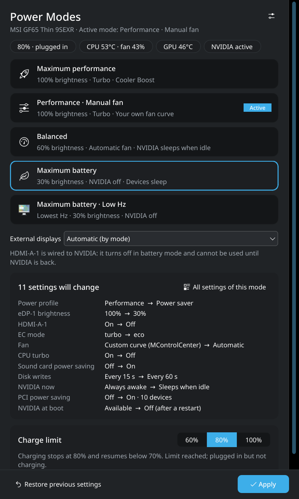

<div dir="rtl">

# msi-ultrapower

**أوضاع الطاقة لحواسيب MSI المحمولة على KDE Plasma.**

[English](README.md) · [Türkçe](README.tr.md) · [Русский](README.ru.md) · [Español](README.es.md) · **العربية**

بنقرة واحدة ينقل حاسوب MSI المحمول بين أوضاع الأداء والتوازن والبطارية. يضبط كل وضع معًا ملف
الطاقة، ومعدل تحديث الشاشة وسطوعها، والمروحة ووضع EC، وتوربو المعالج، وإضاءة لوحة المفاتيح،
وتوفير طاقة الأجهزة، وبطاقة NVIDIA، ويتراجع عن كل شيء إذا فشلت أي خطوة.



## التثبيت

على Arch أو CachyOS أو EndeavourOS أو Manjaro مع KDE Plasma 6:

</div>

```sh
curl -fsSL https://raw.githubusercontent.com/bugrakaann/msi-ultrapower/main/install.sh | bash
```

<div dir="rtl">

للتحديث، شغّل الأمر نفسه مرة أخرى. للتحكم في المروحة ووضع EC و Cooler Boost وحد الشحن، ثبّت
أيضًا برنامج التشغيل [msi-ec](https://github.com/BeardOverflow/msi-ec) من AUR
(`msi-ec-dkms-git`) ثم أعد التشغيل. بدونه يعمل كل ما عدا ذلك.

</div>

<details>
<summary dir="rtl">التثبيت يدويًا</summary>

```sh
git clone https://github.com/bugrakaann/msi-ultrapower.git
cd msi-ultrapower
make install
```

</details>

<div dir="rtl">

## طريقة الاستخدام

1. افتح **أوضاع الطاقة** من قائمة التطبيقات.
2. اختر وضعًا. تعرض النافذة بالضبط ما سيتغير على حاسوبك.
3. اضغط **تطبيق** وأدخل كلمة المرور.

للعودة إلى ما كانت عليه الإعدادات قبل أول استخدام، اضغط **استعادة الإعدادات السابقة**. تطفئ
أوضاع البطارية بطاقة NVIDIA تمامًا بعد إعادة التشغيل، وتخبرك النافذة متى يلزم ذلك.

### الأوضاع

| الوضع | ماذا يفعل |
|---|---|
| **أقصى أداء** | ملف الأداء، توربو، Cooler Boost، أعلى معدل تحديث، سطوع 100% |
| **الأداء · مروحة يدوية** | مثل السابق مع منحنى المروحة الخاص بك (يُضبط في MControlCenter) |
| **متوازن** | ملف متوازن، مروحة تلقائية، سطوع 60%، تنام NVIDIA عند الخمول |
| **أقصى عمر للبطارية** | توفير الطاقة، بلا توربو، سطوع 30%، NVIDIA مطفأة، الأجهزة نائمة، إضاءة لوحة المفاتيح مطفأة |
| **أقصى عمر للبطارية · تردد منخفض** | مثل السابق مع أدنى معدل تحديث للشاشة |

تحتفظ الشاشات الخارجية بدقتها ومعدل تحديثها. تنطفئ المخارج الموصولة ببطاقة NVIDIA في أوضاع
البطارية لأن NVIDIA تكون مطفأة.

### الإعدادات (⚙)

- **حد الشحن** – اشحن البطارية حتى 60 أو 80 أو 100%. تطيل نسبة 60–80% عمر البطارية.
- **الوضع التلقائي** – تبديل الوضع عند توصيل الشاحن أو فصله.
- **عدم طلب كلمة مرور المسؤول** – لا كلمة مرور لتبديل الأوضاع وحد الشحن والوضع التلقائي.
- **البدء في علبة النظام عند تسجيل الدخول** – بدّل الأوضاع واعرض البطارية واستهلاك الطاقة والحرارة من العلبة.
- **خيارات أوضاع البطارية** – نوم الأجهزة، إطفاء البلوتوث.
- **اللغة** – English، Türkçe، Русский، Español، العربية.

### سطر الأوامر

| الأمر | الوظيفة |
|---|---|
| `msi-ultrapower balanced` | تطبيق وضع: `performance` و `performance-manual` و `balanced` و `battery` و `battery-low-hz` |
| `msi-ultrapower battery --dry-run` | عرض ما سيتغير دون تغيير أي شيء |
| `msi-ultrapower restore` | العودة إلى الإعدادات قبل أول وضع |
| `msi-ultrapower charge 80` | حد الشحن: 60 أو 80 أو 100 |
| `msi-ultrapower status` | القيم الحالية |
| `msi-ultrapower doctor` | ما الذي يعمل على هذا الحاسوب |

## التوافق

طُوّر على MSI GF65 Thin 9SEXR. لا يفترض البرنامج طرازًا واحدًا، بل يكتشف ما يدعمه حاسوبك: أوضاع
EC والمروحة، ومعدلات تحديث الشاشة (120–240 هرتز)، وتوربو Intel أو AMD، ووجود NVIDIA. تُتخطى
الميزات غير الموجودة وتظهر في النافذة.

- **مفتاح MUX:** إذا كان وضع GPU في BIOS هو *Discrete* فإن NVIDIA تشغّل الشاشة ولن يطفئها
  البرنامج. اختر *MSHybrid/Optimus* في BIOS لاستخدام أوضاع البطارية بالكامل.
- تتعارض **TLP و auto-cpufreq و tuned** مع ملفات الطاقة، وينبّهك البرنامج إذا كان أحدها يعمل.

لإخبارنا كيف يعمل على طرازك،
[افتح issue](https://github.com/bugrakaann/msi-ultrapower/issues/new?template=model-report.md)
مع ناتج الأمر `msi-ultrapower doctor`.

## إلغاء التثبيت

شغّل `msi-ultrapower restore` أولًا إن أردت استعادة إعداداتك السابقة، ثم:

</div>

```sh
sudo pacman -R msi-ultrapower
```

<div dir="rtl">

تبقى إعداداتك في `~/.config/msi-ultrapower` و `~/.local/share/msi-ultrapower`.

## حل المشكلات

**لا يبدأ سطح المكتب بعد اختيار وضع بطارية.** انتقل إلى طرفية نصية بالضغط على Ctrl+Alt+F3،
وسجّل الدخول، ثم شغّل:

</div>

```sh
sudo /usr/lib/msi-ultrapower/msi-ultrapower-gpu-boot hybrid
```

<div dir="rtl">

ثم أعد التشغيل. هذا يزيل فقط حظر NVIDIA الذي أضافه msi-ultrapower.

**فشل شيء ما.** اضغط **عرض السجل** في النافذة، أو شغّل الوضع نفسه من الطرفية لرؤية الناتج كاملًا.

## إخلاء المسؤولية

msi-ultrapower مشروع غير رسمي، وليس تابعًا لشركة Micro-Star International (MSI) ولا معتمدًا منها.
يغيّر إعدادات وحدة التحكم المدمجة (EC) ووحدات النواة والإقلاع؛ استخدمه على مسؤوليتك. لا يوجد أي ضمان.

## الترخيص

[GPL-3.0-or-later](LICENSE)

</div>
